<!-- ===================== HEADER ===================== -->

 

 

<!-- ===================== ABOUT ===================== -->
## &nbsp; About Me

I am a **Computer Science and Engineering graduate from East West University**, specializing in **full-stack web development** with a growing focus on **Artificial Intelligence** and intelligent software solutions.

I design, build and deploy scalable web applications using **React, Next.js, TypeScript, Express.js, Django and PostgreSQL**. My experience includes production-oriented projects such as **e-commerce platforms, streaming systems and AI-powered applications**, including **PixieGPT**, a Retrieval-Augmented Generation (RAG) question-answering platform built with **LangChain, FAISS, Sentence Transformers and FastAPI**.

I have a strong foundation in software development, problem solving, API integration, database management and system design, and I enjoy building reliable, efficient and maintainable software.

&nbsp;**Building:** AI-powered applications using Retrieval-Augmented Generation (RAG) 
&nbsp;**Learning:** C#, ASP.NET Core MVC and the wider .NET ecosystem 
&nbsp;**Looking for:** Internship / junior developer roles (remote or on-site in Bangladesh) 
&nbsp;**Portfolio:** [junaed10portfolio.vercel.app](https://junaed10portfolio.vercel.app/) 
&nbsp;**Contact:** [junaed10rafi@gmail.com](mailto:junaed10rafi@gmail.com)

 

<!-- ===================== TECH STACK ===================== -->
## &nbsp; Tech Stack

<!-- Click any icon to open the official website. -->

**Languages** 

 

**Frontend** 

 

**Backend & APIs** 

 

**Databases** 

 

**AI, ML & Data** 

 

**Tools & DevOps** 

 

**Currently Learning** 

 

<!-- ===================== PROJECTS ===================== -->
## &nbsp; Featured Projects

<!--
  Project cards live in /assets (exact file names, case-sensitive):
  card-flixora.svg, card-miraan.svg, card-pixiegpt.svg, card-oporajita.svg, card-portfolio.svg
  Each card is 480x588. Click a card to open the live project.
  Full project details are in the collapsible sections below the cards.
-->

<table>
  <tr>
    <td align="center" valign="top">
      
    </td>
    <td align="center" valign="top">
      
    </td>
  </tr>
  <tr>
    <td align="center" valign="top">
      
    </td>
    <td align="center" valign="top">
      
    </td>
  </tr>
  <tr>
    <td align="center" valign="top" colspan="2">
      
    </td>
  </tr>
</table>

 

<!-- ---------- Project details (collapsible) ---------- -->

<b>Flixora</b> &nbsp;·&nbsp; Movie, TV Series &amp; Live Streaming Platform

 

 

- Built a movie and TV series streaming platform with **live broadcasting**, a responsive mobile and web interface, and a **media upload system**.
- Implemented a **role-based system** (Admin, Moderator, Subscriber) with real-time admin-to-admin and user-to-admin **messaging and notifications using WebSockets**.
- Developed with Next.js, Express.js and Clerk authentication, plus multiple APIs for movie, rating and media data.
- Integrated **subscription management and a payment workflow** for premium streaming access.

   

<b>Miraan Bangladesh</b> &nbsp;·&nbsp; Full-Stack Fashion E-Commerce

 

 

- Production-ready fashion e-commerce platform with a product catalog, **advanced filtering, cart, checkout, promo codes and an invoice system**.
- Role-based **admin dashboard** for managing products, banners, inventory, users and analytics reports.
- Developed using Next.js 14, React 18, TypeScript, PostgreSQL (Prisma ORM) and Clerk authentication.
- Integrated ImageKit CDN, SWR API fetching, a live chat widget and Bangladesh-specific features (৳ currency, 64-district delivery system).

       

<b>PixieGPT</b> &nbsp;·&nbsp; AI-Powered Question Answering Web Platform

 

 

- Built a Next.js and TypeScript Q&amp;A web platform integrated with an **ML-based RAG retrieval system**, using Clerk for secure authentication and Neon PostgreSQL as the database.
- Implemented RAG with NLU, **document chunking (LangChain)**, Pandas/NumPy data processing, **Sentence-Transformer embeddings** and **FAISS vector semantic search**.
- Deployed the frontend on Vercel, with a FastAPI backend.

           

<b>Oporajita (অপরাজিতা)</b> &nbsp;·&nbsp; Bangla Online Marketplace for Pure Products

 

 

- Bangla-language e-commerce storefront for pure, authentic products such as **honey, dates, spices, nuts and seeds, drinks, rice, flour and lentils**.
- Category-wise browsing, **product search**, wishlist, cart with a live item and total summary, and a **flash sale** section.
- Product cards with **offer, new and best-selling labels**, discount percentages, ratings count and quick add-to-cart.

<!-- Add this project's source link and tech stack here when ready. -->

<b>Personal Portfolio</b> &nbsp;·&nbsp; Interactive Developer Portfolio

 

  

- Interactive portfolio website with a **3D animated avatar** hero section, and dedicated About, Work and Contact sections.
- Includes a resume link and quick social links (GitHub, LinkedIn, Instagram) for recruiters.
- Languages: TypeScript 60.2% &nbsp;·&nbsp; CSS 38.9% &nbsp;·&nbsp; Other 0.9%

   

 

 

<!-- ===================== STATS ===================== -->
## &nbsp; GitHub Analytics

<!-- Static animated cards stored in /stats (no workflow or token needed). Update them manually when you want. -->

  

 

<!-- ===================== CONTACT ===================== -->
## &nbsp; Let's Connect

I am open to **internships and junior developer opportunities**, and always happy to talk about web development, AI and new ideas. You can see my work on my [portfolio](https://junaed10portfolio.vercel.app/).

