<!-- ===================== HEADER ===================== -->

 

<!-- ===================== ABOUT ===================== -->
## 👨‍💻 About Me

I am a **Computer Science and Engineering graduate from East West University**, specializing in **full-stack web development** with a growing focus on **Artificial Intelligence** and intelligent software solutions.

I design, build and deploy scalable web applications using **React, Next.js, TypeScript, Express.js, Django and PostgreSQL**. My experience includes production-oriented projects such as **e-commerce platforms, streaming systems and AI-powered applications**, including **PixieGPT**, a Retrieval-Augmented Generation (RAG) question-answering platform built with **LangChain, FAISS, Sentence Transformers and FastAPI**.

I have a strong foundation in software development, problem solving, API integration, database management and system design, and I enjoy building reliable, efficient and maintainable software.

<table>
  <tr>
    <td>🔭 <b>Building</b></td>
    <td>AI-powered applications using Retrieval-Augmented Generation (RAG)</td>
  </tr>
  <tr>
    <td>🌱 <b>Learning</b></td>
    <td>C#, ASP.NET Core MVC and the wider .NET ecosystem</td>
  </tr>
  <tr>
    <td>💼 <b>Looking for</b></td>
    <td>Internship / junior developer roles (remote or on-site in Bangladesh)</td>
  </tr>
  <tr>
    <td>📫 <b>Contact</b></td>
    <td><a href="mailto:junaed10rafi@gmail.com">junaed10rafi@gmail.com</a></td>
  </tr>
</table>

 

<!-- ===================== TECH STACK ===================== -->
## 🛠️ Tech Stack

<!-- Click any icon to open the official website. -->

**Languages** 
&nbsp;&nbsp;
&nbsp;&nbsp;
&nbsp;&nbsp;
&nbsp;&nbsp;
&nbsp;&nbsp;
&nbsp;&nbsp;
&nbsp;&nbsp;
&nbsp;&nbsp;

**Frontend** 
&nbsp;&nbsp;
&nbsp;&nbsp;
&nbsp;&nbsp;
&nbsp;&nbsp;
&nbsp;&nbsp;
&nbsp;&nbsp;
&nbsp;&nbsp;

**Backend & APIs** 
&nbsp;&nbsp;
&nbsp;&nbsp;
&nbsp;&nbsp;

**Databases** 
&nbsp;&nbsp;
&nbsp;&nbsp;
&nbsp;&nbsp;

**AI, ML & Data** 
&nbsp;&nbsp;
&nbsp;&nbsp;
&nbsp;&nbsp;
&nbsp;&nbsp;
&nbsp;&nbsp;
&nbsp;&nbsp;

**Tools & DevOps** 
&nbsp;&nbsp;
&nbsp;&nbsp;
&nbsp;&nbsp;
&nbsp;&nbsp;
&nbsp;&nbsp;
&nbsp;&nbsp;

**Currently Learning** 
&nbsp;&nbsp;

 

<!-- ===================== PROJECTS ===================== -->
## 🚀 Featured Projects

<!--
  Replace every REPLACE_REPO_NAME below with your real repository name.
  The cards load automatically from your public repositories.
-->

<table>
  <tr>
    <td width="50%" align="center">
      
       <b>PixieGPT</b> - RAG question-answering platform (Python, FastAPI, LangChain, FAISS)
    </td>
    <td width="50%" align="center">
      
       <b>E-Commerce Platform</b> - Full-stack store (React/Next.js, TypeScript, Express, PostgreSQL)
    </td>
  </tr>
  <tr>
    <td width="50%" align="center">
      
       <b>Streaming Platform</b> - Video streaming web app (Next.js, Django, PostgreSQL)
    </td>
    <td width="50%" align="center">
      
    </td>
  </tr>
</table>

 

<!-- ===================== STATS ===================== -->
## 📊 GitHub Analytics

<!--
  OPTIONAL: contribution snake. First add the workflow file .github/workflows/snake.yml,
  run it once from the Actions tab, then remove this comment markers.

  

-->

 

<!-- ===================== CONTACT ===================== -->
## 🤝 Let's Connect

I am open to **internships and junior developer opportunities**, and always happy to talk about web development, AI and new ideas.

